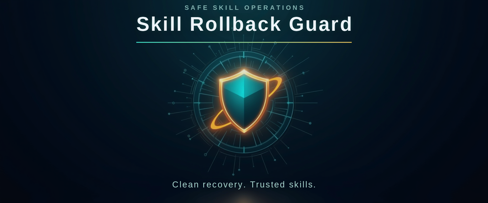

# hermes-skill-rollback-guard



A native Hermes plugin that clears the `<name>.rollback-broken` symlink residue left behind by
`skill_manage`'s batch **rollback** on Hermes builds whose rollback cleanup is symlink-blind.

## The bug it cleans up

`skill_manage` applies a batch atomically: it snapshots every touched skill, and if any operation
fails it rolls them all back. On a profile that installs each skill as a **symlink** into its
canonical source directory, the pre-fix rollback did this:

```python
aside = post_dir.with_name(post_dir.name + ".rollback-broken")
shutil.rmtree(aside, ignore_errors=True)   # ← refuses a symlink, and ignore_errors swallows it
post_dir.rename(aside)
shutil.copytree(snap, pre_dir)             # restore succeeds → `pre_dir` exists again
shutil.rmtree(aside, ignore_errors=True)   # ← no-ops on the link → residue is left behind
```

`shutil.rmtree` refuses to operate on a symbolic link; with `ignore_errors=True` the refusal is
silent, so a stray `demo.rollback-broken` link survives every rolled-back batch. The link still
points at the same canonical directory as the live skill, so it is harmless — until it isn't:
a subsequent rollback renames the *previous* residue aside again and you get
`demo.rollback-broken.rollback-broken`, and the mess accretes.

The upstream fix replaces both `shutil.rmtree(aside, ...)` calls with a symlink-safe helper that
unlinks a link and only recurses into a real directory. **Once your core carries that fix this
plugin is a no-op** and you can uninstall it.

## What the plugin does

It registers the documented `tool_execution` middleware. After a `skill_manage` call it scans the
**active profile's writable skills directory** — the only tree `skill_manage` installs into, obtained
from the public `skills_tool.skill_search_dirs()` API — and unlinks residue `<name>.rollback-broken`
**symlinks**, and only those whose live canonical skill sits right beside them. Shared/builtin,
project, `skills.create_dir` and external roots, and every other profile, are deliberately out of
scope: a plugin must not sweep a skill tree it does not own. It never patches core, never rebinds a
core symbol, and touches nothing else. The tool result is passed through unchanged.

## Safety — it cannot eat your skills

Unlinking a residue is only allowed when a **live canonical sibling** exists next to it: the base
name with every `.rollback-broken` suffix stripped, present as a skill directory (or a symlink that
resolves into one) that actually contains a `SKILL.md`. After a *successful* rollback the skill has
already been recreated under its canonical name, so the residue is a pure duplicate. When that
sibling is absent — or present but not a real skill (no `SKILL.md`) — the residue may be the *only
remaining reference* to a skill whose restore did not complete; the guard leaves it in place and logs
it. Concretely:

- Only a `.rollback-broken` **symlink** is ever a candidate — the sole shape the bug produces.
  `os.unlink` never follows a symlink, so a residue link's **target directory is never touched**.
- A `.rollback-broken` **regular file** is never touched — it may hold unique user data.
- A `.rollback-broken` **directory** (which the bug never produces) is never removed — no recursive
  delete.
- Residue with no live canonical sibling, or a sibling without a `SKILL.md` — a failed or
  hand-interrupted restore — is **preserved**.
- Cleanup is scoped to the active profile's writable skill root; shared/external/builtin roots and
  other profiles are never scanned.
- On an already-fixed or unrecognized core the guard does nothing at all.

## Capability guard

The plugin inspects the running core through the public module shape and classifies it:

| State | Meaning | Behaviour |
|---|---|---|
| `fixed` | symlink-safe helper present | no-op — there is nothing to clean |
| `unfixed` | rollback entry point present, helper absent | cleans residue after `skill_manage` |
| `unknown` | module absent / unrecognized shape | fail safe — no-op |

## Install

```bash
mkdir -p ~/.hermes/plugins/hermes-skill-rollback-guard
tar -xzf hermes-skill-rollback-guard-0.1.0.tar.gz -C ~/.hermes/plugins/
```

Then enable it in `config.yaml`:

```yaml
plugins:
  enabled:
    - hermes-skill-rollback-guard
```

No core patch and no extra Python dependencies. It uses only the `tool_execution` middleware seam
and the public `skills_tool` API.

## Limitations (honest)

- **Post-tool cleanup only.** The guard runs *after* a `skill_manage` tool call flows through the
  middleware chain. There is **no startup sweep, no filesystem watcher and no scheduled scan** —
  residue that already exists when the plugin loads is not cleared until the next `skill_manage`
  call. (You can clean the backlog now with `rollback_guard.clean_residue()`.)
- **Only while core reports `unfixed`.** On a core that already carries the symlink-safe fix the
  guard is inert by design, so it will not mask the fix or double-clean.
- **Skill dirs only.** It scans the active profile's writable skills dir (the active root from
  `skills_tool.skill_search_dirs()`), to a depth of two (the depth the batch paths use).
  Shared/builtin, project, `skills.create_dir` and external roots, and other profiles, are out of
  scope by design — `all_skills_roots()` exposes the wider tree for explicit use.
- **No automatic remediation of a failed restore.** If a residue is the only surviving copy, the
  guard preserves it and logs the path; recovery is a human decision.
- **Middleware seam required.** On a Hermes build that does not expose the `tool_execution`
  middleware contract the plugin will not load; nothing else is attempted.

## Test

```bash
HERMES_SRC=/path/to/hermes-agent ./run_tests.sh
```

Runs under a disposable `HERMES_HOME`; no core file is touched. The suite covers the scanner, the
safety gate, the capability classifier, the real Hermes discovery/import/register path and the real
`tool_execution` middleware chain. The end-to-end acceptance test drives the genuine **pre-fix
rollback** on a symlinked skill — from a real pre-fix `skill_manager_batch.py` when one is available
(`PREFIX_CORE=/path/to/pre-fix/skill_manager_batch.py`), otherwise from the faithful reconstruction
shipped in `tests/fixtures/prefix_core/` — then proves the residue is cleared and the skill and its
target survive, and that a residue which is a skill's only surviving copy is preserved.

## Release

```bash
./build.sh            # writes dist/hermes-skill-rollback-guard-<version>.{tar.gz,zip} + SHA256SUMS
```

CI (`.github/workflows/ci.yml`) runs the suite against a pinned Hermes checkout; the release
workflow builds archives on a `v*` tag and attaches them to the GitHub release.

## Artwork

`assets/banner.png` is AI-generated, not drawn by hand. It was rendered on a local ComfyUI
instance with the **FLUX.1 [dev]** (fp8) diffusion model at 1536×640; the wordmark
("Skill Rollback Guard"), the "SAFE SKILL OPERATIONS" eyebrow and the tagline
("Clean recovery. Trusted skills.") are not diffusion output — they are overlaid deterministically
so the wording is exact, because diffusion renders text unreliably.

The artwork is **not covered by the MIT licence below**, which applies to the plugin source only.
The FLUX.1 [dev] model weights are released by Black Forest Labs under the
**FLUX.1 [dev] Non-Commercial License**; Black Forest Labs states it claims no ownership rights in
the model's outputs and that outputs may be used for any purpose (including commercially) except to
train a competing model. Verify the current model licence before any commercial redistribution of
the image.

## License

MIT — Copyright (c) 2026 ErtzFiend.
